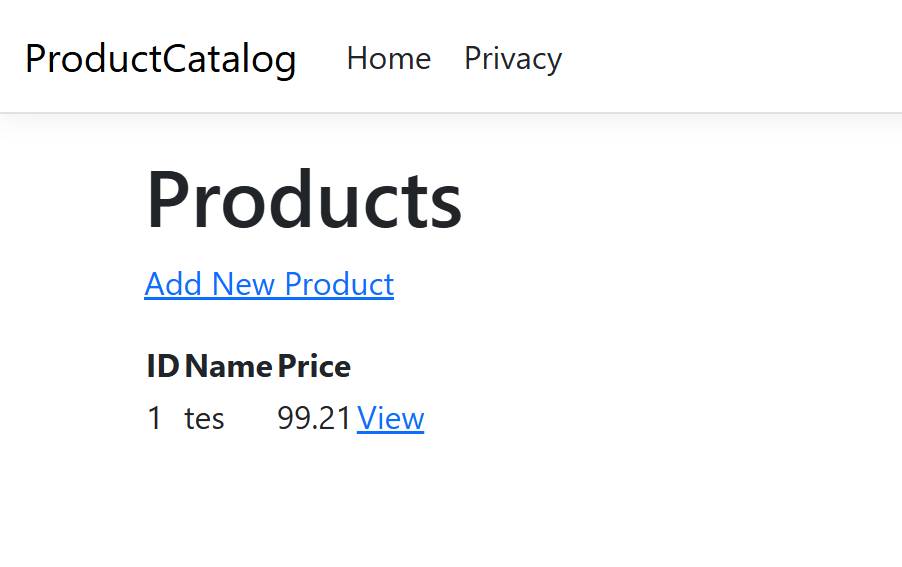
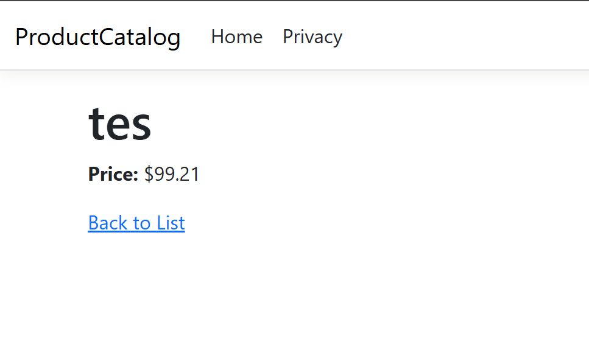

# Product Catalog

This program allows the user to add new products to a JSON database, and also allows the user to view those products. They can also be edited by manually going into the `data/products.json` file.

# Example Images

